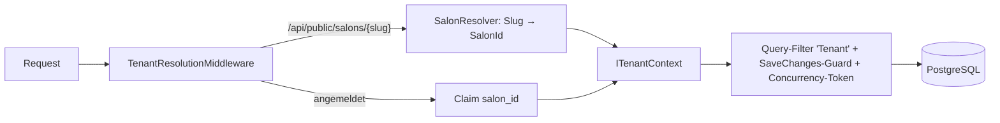

# Architektur (Gerüst)

Wird mit jedem Schritt erweitert; die verbindlichen Regeln stehen in [CLAUDE.md](../CLAUDE.md).

## Überblick

Angular (Frontend) → ASP.NET Core 10 Web API → PostgreSQL. Auslieferung und HTTPS über Caddy.

## Aufrufkette

Browser: Komponente → Feature-Service → ApiClient → Caddy (`/api`) → Server: Controller → Service (hinter Interface) → EF Core (`IAppDbContext`) → PostgreSQL.

## Schichten (Backend)

- `Kalora.Api` – Controller, Middleware, `Program.cs`
- `Kalora.Application` – Service-Interfaces und Implementierungen, DTOs, Validatoren, `IAppDbContext`
- `Kalora.Domain` – Entitäten, reine Regeln (Verfügbarkeit, Statusautomat), keine Abhängigkeiten
- `Kalora.Infrastructure` – EF Core, Migrationen, Mail, Kalender, `TimeProvider`

## Mandantenfähigkeit

Alle Salons teilen sich eine Datenbank; jede salonbezogene Tabelle trägt `SalonId`. Begründung und verworfene Alternativen: [ADR 0001](adr/0001-multi-tenancy.md).

- **Lesen:** globaler Query-Filter auf `Salon` und allen `ISalonOwned`-Entitäten; ohne Mandant keine Daten.
- **Schreiben:** `TenantSaveGuard` setzt/prüft `SalonId`, `SalonId` ist zusätzlich Concurrency-Token (gefälschte Entitäten treffen keine Zeile).
- **Umgehung:** nur `AllSalons()` / `AllTenants<T>()`, per Architekturtest auf eine feste Dateiliste beschränkt.

## Anmeldung und Rollen

Begründung: [ADR 0002](adr/0002-authentication.md). Cookie-Sitzung (ASP.NET Core Identity), ein Nutzer gehört zu genau einem Salon; Salon und Rolle stehen als Claims im Cookie.

| Endpunkt | Zugriff | Zweck |
|----------|---------|-------|
| `GET /api/antiforgery` | offen | setzt das `XSRF-TOKEN`-Cookie; schreibende Anfragen senden es als `X-XSRF-TOKEN` |
| `POST /api/auth/register` | offen | Inhaber:in + Salon (30 Tage Test) anlegen, anmelden |
| `POST /api/auth/login`, `/logout` | offen | Sitzung starten/beenden; mit aktiver 2FA zusätzlich `twoFactorCode` oder `recoveryCode` |
| `POST /api/auth/confirm-email`, `/forgot-password`, `/reset-password` | offen | E-Mail bestätigen, Passwort zurücksetzen |
| `GET /api/me` | angemeldet | Profil, Salon, Rolle, 2FA-Status |
| `POST /api/auth/two-factor/setup`, `/enable`, `/disable`, `/recovery-codes` | angemeldet | TOTP einrichten und verwalten |
| `POST /api/invitations` | Owner, Manager | Mitarbeitende einladen (Manager nur als Staff) |
| `GET /api/public/invitations/{token}`, `POST …/accept` | Token | Einladung ansehen und annehmen |

Policies: `SalonMember` (Owner, Manager, Staff), `SalonManager` (Owner, Manager), `SalonOwner`, `PlatformAdmin`. Fehlercodes u. a.: `auth.invalid_credentials`, `auth.locked_out`, `auth.two_factor_required`, `auth.email_taken`, `auth.invalid_token`, `invitation.invalid`, `invitation.expired`, `security.antiforgery_failed`.

## Salon-Einstellungen

Alle Endpunkte unter `/api/settings` für Owner und Manager (Policy `SalonManager`), jeder Salon sieht und ändert nur seine eigenen Daten (Mandantenfilter).

| Endpunkt | Zweck |
|----------|-------|
| `GET/PUT /api/settings/profile` | Name, Slug, Branche, Adresse, Telefon, Zeitzone, Standardsprache, Impressum, Link zur Datenschutzerklärung. Den Slug ändert nur der Owner (`settings.slug_owner_only`), er muss eindeutig, URL-tauglich (3–40 Zeichen) und nicht reserviert sein |
| `GET /api/settings/slug-suggestion?name=` | freier Slug aus dem Namen (`name`, `name-2`, …) |
| `GET/PUT /api/settings/booking-rules` | Zeitraster (5/10/15/30 min), Mindestvorlauf, Buchungshorizont, Stornofrist, Auto-Bestätigung, Frist für unbeantwortete Anfragen (`request_expiry_hours`), Löschfrist |
| `GET/PUT /api/settings/opening-hours` | Wochenplan, Montag zuerst, mehrere Zeiträume pro Tag (höchstens 4, Zeiträume dürfen sich berühren, nicht überlappen); `PUT` ersetzt die ganze Woche, nicht genannte Tage sind geschlossen |
| `GET/POST /api/settings/closures`, `DELETE …/{id}` | Schließtage: ein Tag oder ein Bereich (bis 62 Tage, schon geschlossene Tage werden übersprungen); „heute“ ist der Kalendertag in der Zeitzone des Salons, die Liste zeigt nur heutige und kommende |

Uhrzeiten reisen als `"HH:mm"` (`TimeOnlyJsonConverter`), Wochentage und Enums als Text. Prüfungen mit FluentValidation liefern stabile Codes (`settings.*`, `opening_hours.*`, `closure.*`). Der Slug-Dienst (`ISlugAllocator`) prüft die Eindeutigkeit über alle Salons und ist eine der wenigen Stellen mit Mandantenfilter-Umgehung. Die Zeitzonen-ID muss eine gültige IANA-ID sein; das Laufzeit-Image braucht dafür `tzdata` (Prompt 25).

## Leistungen

Alle Endpunkte unter `/api/catalog`. Lesen dürfen alle Rollen des Salons (die Terminbuchung im Kalender braucht die Liste), ändern nur Owner und Manager (Policy `SalonManager`). Jede Änderung antwortet mit dem ganzen neuen Katalog (Kategorien samt Leistungen in Anzeigereihenfolge), das Frontend ersetzt damit seinen Stand und braucht keine Einzelabgleiche.

| Endpunkt | Zweck |
|----------|-------|
| `GET /api/catalog` | Kategorien mit Leistungen; `hasAppointments` zeigt, ob die Leistung schon Termine hat |
| `POST/PUT/DELETE /api/catalog/categories[/{id}]` | Kategorie anlegen, umbenennen, löschen (nur leer, sonst `category.not_empty`) |
| `PUT /api/catalog/categories/order` | neue Reihenfolge aller Kategorien |
| `POST/PUT/DELETE /api/catalog/services[/{id}]` | Leistung anlegen, ändern (auch in andere Kategorie verschieben, aktivieren/deaktivieren), löschen |
| `PUT /api/catalog/categories/{id}/services/order` | neue Reihenfolge der Leistungen einer Kategorie |
| `POST /api/catalog/templates/apply` | Branchenvorlage übernehmen (Branche des Salons, wenn nicht angegeben) |

- **Preis und Dauer:** Preis in Cent (`0` bis `1.000.000`, `0` = kostenlos), Währung fest `EUR`, „ab“-Preis über `priceIsFrom`. Dauer 5 bis 720 min und Puffer davor/danach 0 bis 240 min jeweils in 5-Minuten-Schritten. Das Frontend rechnet Euro-Eingaben (`25`, `25,5`, `25.50`, `1.250,00`) in Cent um (`parsePriceToCents`); die Prüfung liegt zusätzlich im Validator.
- **Löschen:** Eine Leistung mit Terminen lässt sich nicht löschen (`service.has_appointments`, Konflikt), nur deaktivieren: Termine behalten so ihre Leistung, und sie wird nicht mehr online angeboten. Eine Kategorie lässt sich nur löschen, wenn sie leer ist.
- **Reihenfolge:** Die Anfrage enthält die vollständige Liste der IDs; fehlende, doppelte oder fremde IDs ergeben `catalog.order_mismatch`. So überschreibt eine veraltete Ansicht nie neuere Änderungen eines anderen Geräts stillschweigend.
- **Mandanten:** Kategorie und Leistung werden immer über den Mandantenfilter geladen. Eine fremde Kategorie-ID ergibt `category.not_found` (404), auch beim Anlegen und Verschieben.
- **Vorlagen:** `Catalog/Templates/service-templates.json` (eingebettete Ressource, Schicht Application) enthält je Branche Kategorien und Leistungen mit Namen in `de`, `en` und `tr` und Richtpreisen zum Anpassen. Beim Übernehmen werden die Namen in der Standardsprache des Salons geschrieben (Rückfall `de`) und **hinten angehängt**, so entstehen bei zweimaligem Übernehmen Dopplungen, aber nie verlorene Daten. Ein Unit-Test prüft alle Vorlagen (Sprachen vollständig, Grenzen eingehalten).
- **Frontend (`features/services`):** Seite mit Kategorien und Leistungen, Sortieren per Ziehen (CDK Drag & Drop, Ziehgriff) und gleichwertig per Menü „Nach oben/unten“ für Tastatur und Screenreader. Die neue Reihenfolge erscheint sofort und wird gespeichert; schlägt das fehl, kommt die alte Reihenfolge zurück. Dialoge für Leistung (Puffer unter „Erweitert“), Kategorie und Bestätigung. Dauer wird mit `Intl` in der Sprache der Oberfläche geschrieben (`LocaleFormatService.formatDuration`).

## Team, Arbeitszeiten, Abwesenheiten

Zwei Services mit je einem Controller (`StaffController`, `StaffScheduleController`), alle Routen unter `/api/staff`. Lesen darf jedes Mitglied des Salons, Ändern nur Owner und Manager (Policy `SalonManager`), mit einer Ausnahme: Mitarbeitende tragen **eigene Abwesenheiten** selbst ein. Wer ihre Arbeitszeiten und Abwesenheiten lesen darf, entscheidet der Service (Manager: alle, sonst nur die eigene Spalte, sonst `auth.forbidden`), damit Krankmeldungen nicht für alle Kolleg:innen sichtbar sind.

| Endpunkt | Zweck |
|----------|-------|
| `GET/POST /api/staff`, `GET/PUT /api/staff/{id}` | Mitarbeitende (Kalenderspalten): Name, Farbe (`#RRGGBB`), online buchbar, Auto-Bestätigung, aktiv. Inaktive stehen am Ende. `POST` mit `linkToCurrentUser` legt die eigene Spalte an („nur ich“, einmal pro Person: `staff.already_linked`). Die Antwort zeigt `hasLogin`, `role`, `isMe`, `invitationPending` |
| `GET/PUT /api/staff/{id}/services` | Fähigkeiten: Leistungen der Person, optional mit eigener Dauer (5-Minuten-Schritte). `PUT` ersetzt die ganze Liste; fremde oder doppelte Leistungen werden abgelehnt |
| `GET/PUT /api/staff/{id}/working-hours` | Arbeitszeiten als Wochenplan mit „gilt ab“ (siehe unten) |
| `GET/POST /api/staff/{id}/absences`, `DELETE …/{absenceId}` | Abwesenheiten (Urlaub, krank, privat) |

Eingeladen wird mit dem bestehenden `POST /api/invitations` (Prompt 04), die Oberfläche legt erst die Person an und lädt dann ein; scheitert die Einladung, bleibt die Person bestehen und kann auf der Detailseite erneut eingeladen werden.

- **Dienstplan mit Stichtag:** Ein Plan besteht aus Blöcken mit gleichem `ValidFrom`. Speichern ab Datum *D* ersetzt **alle** Blöcke ab *D* (auch spätere, bereits geplante Pläne); Pläne, die vorher begonnen haben und über *D* hinaus liefen, enden am Tag davor (`ValidTo = D − 1`). *D* darf nicht in der Vergangenheit liegen (`staff.schedule_date_in_past`, „heute“ ist der Kalendertag in der Zeitzone des Salons). Ein Plan ohne einen einzigen Arbeitsblock wird abgelehnt (`staff.schedule_empty`): wer nicht mehr arbeitet, wird deaktiviert. Die Blockregeln sind dieselben wie bei den Öffnungszeiten (`OpeningHoursPlanValidator`). Die Antwort enthält den heute geltenden und alle künftigen Pläne; abgelaufene werden nicht mehr geliefert. Die Verfügbarkeitsberechnung (Prompt 10) schneidet den Plan mit den Öffnungszeiten, sie werden hier nicht gegeneinander geprüft.
- **Abwesenheiten:** Ganze Kalendertage in der Zeitzone des Salons, erster und letzter Tag eingeschlossen (höchstens 366 Tage). Gespeichert wird als UTC-Bereich `[Mitternacht erster Tag, Mitternacht nach letztem Tag)` (`SalonTime`, berücksichtigt Sommerzeit und Zeitzonen ohne Mitternacht). Eine Abwesenheit darf schon laufen, aber nicht komplett in der Vergangenheit liegen (`absence.date_in_past`). Überschneidungen mit anderen Abwesenheiten sind erlaubt und schaden nicht.
- **Terminwarnung:** Liegen **offene oder bestätigte** Termine (Status `Requested`, `Confirmed`) der Person im Zeitraum, antwortet `POST` trotzdem mit Erfolg und liefert sie in `affectedAppointments` (Zeit, Leistung, Kundenname, Status) zurück. Es wird nichts abgesagt oder verschoben. Die Liste der Abwesenheiten trägt je Eintrag `conflictCount`. Grenzfälle (Termin endet genau zu Beginn, beginnt genau am Ende) zählen nicht.
- **Zeitzone im Frontend:** `GET /api/me` liefert jetzt `salon.timeZone`; Datum „heute“ und Terminzeiten in der Oberfläche richten sich danach, nicht nach dem Browser.
- **Frontend (`features/team`, eigene Routen in `team.routes.ts`):** Teamliste mit Initialen-Avatar und Kalenderfarbe (Textfarbe nach WCAG-Kontrast, alle angebotenen Farben erreichen 4,5:1), Detailseite mit den Tabs Leistungen (Checkliste mit optionaler eigener Dauer), Arbeitszeiten (gemeinsamer `WeekScheduleEditor` aus `shared/`, Liste der Pläne, „Gilt ab“) und Abwesenheiten. Mitarbeitende ohne Verwaltungsrechte sehen im Menü „Abwesenheiten“ (`/app/absences`) statt „Team“.
- **Noch nicht enthalten:** Reihenfolge der Spalten ändern (neue Personen kommen ans Ende), Personen löschen (nur deaktivieren, Termine verweisen auf sie), Plan-Limits je Tarif (Prompt 22).

## Verfügbarkeitsberechnung

Reine Domain-Logik in `Kalora.Domain/Scheduling` (keine Datenbank, keine Systemuhr: „jetzt“ kommt vom Aufrufer), dazu `IAvailabilityService` in der Application-Schicht, der die Daten lädt. Es gibt noch keinen Endpunkt; die öffentliche Buchungs-API (Prompt 11) und der Kalender (Prompt 15) rufen den Service auf.

**Bausteine**

| Typ | Aufgabe |
|-----|---------|
| `Interval`, `IntervalSet` | halboffene UTC-Intervalle `[Start, Ende)`; `Union`, `Intersect`, `Subtract`, `Covers`. Ergebnisse sind sortiert, ohne leere Intervalle, sich berührende (9–13, 13–18) werden zu 9–18 verschmolzen |
| `ZoneClock` (intern) | Wanduhrzeit im Salon ↔ UTC mit Sommerzeit: die übersprungene Stunde im März gibt es nicht (ein Block ab 02:30 beginnt um 03:30), die doppelte Stunde im Oktober liefert beide Zeitpunkte; ein Block, der in der doppelten Stunde endet, endet am späteren Zeitpunkt und deckt so die ganze Wanduhrspanne ab |
| `AvailabilityCalculator` | `Calculate(AvailabilityRequest) → DaySlots[]`, nur Tage mit mindestens einer Startzeit |
| `StaffPicker`, `Slot.BestStaff` | „Egal wer“: wenigste Termine an dem Tag, bei Gleichstand die frühere Kalenderspalte, zuletzt die ID (Ergebnis hängt nie von der Listenreihenfolge ab) |

**Algorithmus je lokalem Tag:** Öffnungsblöcke des Wochentags (Schließtag ⇒ Tag entfällt) ∩ Arbeitszeit der Person (Blöcke mit `ValidFrom ≤ Tag ≤ ValidTo`) − Abwesenheiten − Belegtes = frei. Eine Startzeit *s* der Leistung ist gültig, wenn `[s − Puffer davor, s + Dauer + Puffer danach)` vollständig in **einem** freien Intervall liegt. Danach gelten Vorlauf (`s ≥ jetzt + Vorlauf`) und Horizont (letzter buchbarer Tag = heute + Horizont Tage, in Salonzeit). Tage vor heute werden nie angeboten.

- **Raster:** Vielfache des Zeitrasters ab lokaler Mitternacht (09:00, 09:15, …), nicht ab Öffnungsbeginn. Ein Block ab 09:10 bietet also 09:15 als erste Startzeit. Am Umstelltag wird auf der Wanduhr gerastert, die übersprungene Stunde hat keine Startzeiten, die doppelte zwei.
- **Dauer:** Die Dauer kann je Person abweichen (`StaffService.DurationOverrideMinutes`); `FreeStaff.DurationMinutes` sagt, wie lang der Termin bei dieser Person dauert. Der Puffer der Leistung gilt für alle gleich.
- **Belegt** sind offene und bestätigte Termine (`Requested`, `Confirmed`) mit ihrem `BlockedStart/End` (inklusive Puffer, wie in der Datenbank) und Blocker (`TimeBlock`). Abgelehnte, abgelaufene, stornierte und abgeschlossene Termine blockieren nicht. Ein Termin, der genau zum Ladenschluss endet, oder eine Lücke, die genau passt, sind gültig.
- **Ausgabe:** je Startzeit die freien Personen mit Dauer, Termine an dem Tag und Sortierreihenfolge. Das sind interne Daten; die öffentliche API liefert Kund:innen nur Startzeiten (und bei Wunschperson deren Anzeigename).

**`IAvailabilityService`**

- `GetSlotsAsync(AvailabilityQuery)`: Leistung, optional Person, Zeitraum von höchstens 62 Tagen (`availability.range_invalid`). Lädt mit zehn kleinen Abfragen (Salon, Leistung, Personen samt Fähigkeit, Öffnungszeiten, Schließtage, Arbeitszeiten, Abwesenheiten, Termine, Blocker; mit einem Tag Rand, damit Puffer über Mitternacht erfasst sind). Alles läuft durch den Mandantenfilter.
- `CheckSlotAsync(SlotCheckQuery)`: prüft eine konkrete Startzeit noch einmal (für den Moment der Buchung) und liefert die zu nehmende Person: die gewünschte oder `BestStaff`. Nicht (mehr) angeboten ⇒ `booking.slot_unavailable` (409). Das ersetzt nicht den Exclusion-Constraint, der bei gleichzeitigen Anfragen die letzte Sicherheit bleibt.
- **Zielgruppe:** `Customer` (nur aktive, online buchbare Leistungen und Personen, Vorlauf und Horizont) oder `Internal` (alle aktiven Leistungen und Personen, ohne Vorlauf und Horizont, aber nie in der Vergangenheit). Unpassende Leistungen oder Personen sind für Kund:innen schlicht „nicht gefunden“ (`service.not_found`, `staff.not_found`).

## Öffentliche Buchungs-API

Alles unter `/api/public/salons/{slug}`, ohne Login (`PublicSalonController`). Der Salon kommt allein aus dem Slug in der URL; die Tenant-Middleware ignoriert auf diesen Pfaden jedes Cookie, ein angemeldeter Salon sieht also nie versehentlich Daten eines anderen. Gesperrte (`Suspended`) und gekündigte (`Cancelled`) Salons gelten als „nicht gefunden“, `PastDue` bucht weiter.

| Endpunkt | Antwort |
|----------|---------|
| `GET /` | Name, Adresse, Telefon, Zeitzone, Standardsprache, Sprachen, Öffnungszeiten, Impressum, Datenschutz-Link |
| `GET /services` | aktive, online buchbare Leistungen nach Kategorien (Name, Beschreibung, Preis, „ab“, Dauer); nur solche, die mindestens eine aktive, online buchbare Person anbietet. Keine Puffer, keine internen Felder |
| `GET /staff?serviceId=` | Personen für die Leistung: nur `id`, `displayName`, `color` |
| `GET /availability/days?serviceId=&staffId=&month=yyyy-MM` | Tage des Monats mit mindestens einer freien Startzeit |
| `GET /availability/slots?serviceId=&staffId=&date=` | Startzeiten (`startUtc` und lokale Uhrzeit `time`), ohne Angabe, wer frei ist |
| `POST /appointment-requests` | Terminanfrage, siehe unten; Antwort `201` mit `BookingReceipt` |

**Terminanfrage (`IBookingService`)**

Eingabe: Leistung, `startUtc` (eine der gelieferten Startzeiten), optional Person, Name, E-Mail, optional Telefon und Notiz (höchstens 1000 Zeichen), Sprache (sonst Standardsprache des Salons) und das Honeypot-Feld `website`. Ablauf in **einer Transaktion**:

1. Honeypot gefüllt ⇒ scheinbarer Erfolg (`201`), es wird nichts gespeichert und nichts gemailt; ein Bot lernt nichts.
2. Höchstens **3 offene Anfragen** (`Requested`) je E-Mail und Salon, sonst `booking.too_many_open_requests` (422). Bestätigte Termine zählen nicht.
3. Startzeit erneut prüfen (`IAvailabilityService.CheckSlotAsync`, Zielgruppe `Customer`) und bei „Egal wer“ die Person wählen (wenigste Termine am Tag). Nicht mehr frei ⇒ `booking.slot_unavailable` (409).
4. Kunde im Salon per E-Mail (klein geschrieben) finden oder anlegen; Name, Sprache und eine angegebene Telefonnummer werden aktualisiert, eine fehlende Nummer löscht die alte nicht.
5. Termin mit **Snapshot** (Leistungsname, Preis, „ab“, Währung, Dauer der gewählten Person) und den Puffern der Leistung in `BlockedStart/End`. Status `Confirmed`, wenn der Salon **oder** die gewählte Person automatisch bestätigt, sonst `Requested`. Eine Anfrage läuft nach `RequestExpiryHours` ab, spätestens aber zu Beginn des Termins (`ExpiresAtUtc`).
6. Verwaltungs-Token ableiten (`IManageTokens`: HMAC-SHA256 über die Termin-ID mit `App:ManageTokenSecret`, Base64Url); **nur der SHA-256-Hash** wird gespeichert. Das Token steht im Link der Mail (`/{slug}/appointment/{token}`, die Seite folgt später) und in der Antwort, damit die Oberfläche es direkt anzeigen kann. Weil es ableitbar ist, kann jede spätere Mail (Erinnerung, Absage) den Link erneut erzeugen, ohne das Token zu speichern.
7. Mails in die Outbox (Versand siehe „E-Mail-Versand“): an die Kundschaft `booking.request_received` bzw. `booking.confirmed` in der Sprache der Buchung, an Inhaber:in, Manager:innen und die gebuchte Person (wenn sie ein Login hat) `booking.new_for_salon` in der Standardsprache des Salons.

**Gleichzeitige Anfragen:** Der Exclusion-Constraint `ex_appointments_no_overlap` ist die letzte Sicherheit. Verlieren zwei Anfragen das Rennen, erkennt `ISlotConflictDetector` (Infrastruktur, kennt Npgsql) den Fall, die Transaktion wird zurückgerollt (also auch Kunde und Mails des Verlierers) und die Antwort ist `booking.slot_unavailable`. Bei „Egal wer“ wird bis zu dreimal neu geprüft, weil eine Kollegin noch frei sein kann; dasselbe gilt, wenn PostgreSQL eine Transaktion wegen eines Deadlocks abbricht (zwei gleichzeitige Einfügungen in den Exclusion-Index können sich gegenseitig blockieren) und wenn ein Kunde mit derselben E-Mail im selben Moment angelegt wurde.

**Rate-Limiting** (ASP.NET Core, je IP-Adresse und Art, Festes Fenster, konfigurierbar unter `RateLimiting`): Lesen (Profil, Leistungen, Personen) 120 pro Minute, Verfügbarkeit 60 pro Minute, Anfragen 10 pro 10 Minuten. Überschreitung: `429`, Code `rate_limited`, `Retry-After`. Die IP stammt hinter dem Reverse Proxy aus den Forwarded-Headers.

**Datenschutz:** Keine Antwort enthält Daten anderer Kund:innen, auch nicht indirekt (die Startzeit eines gebuchten Termins verschwindet einfach aus der Liste). Es gibt keine Kundendaten in Logs: Namen, E-Mails und Notizen stehen nur in Datenbank und Outbox.

## Öffentliche Buchungsseite

`features/booking` unter `/:slug` (Kunden brauchen kein Konto). Die Seite nutzt nur die öffentliche API (siehe oben) und kommt mit Sprache aus dem Browser (de, en, tr), Umschalter oben rechts.

**Aufbau:** `PublicLayout` (schlichter Rahmen) → `BookingShell` (Salonname, Adresse mit Link zur Karte, Telefon, aufklappbare Öffnungszeiten; unten Impressum und Datenschutz des Salons) → ein Schritt je Route:

| Route | Schritt |
|-------|---------|
| `/:slug` | 1 Leistung (nach Kategorien, Dauer, Preis, „ab“-Preis) |
| `/:slug/person` | 2 Person, „Egal wer“ ist vorgewählt |
| `/:slug/time` | 3 Datum (Monatskalender, Tage ohne freie Zeit deaktiviert) und Uhrzeit (Chips: Vormittag, Nachmittag, Abend) |
| `/:slug/details` | 4 Name, E-Mail, Telefon, Nachricht, Datenschutz-Hinweis und Zusammenfassung |
| `/:slug/done` | Erfolgsseite: „Anfrage gesendet“ bzw. bei Auto-Bestätigung „Termin bestätigt“ |
| `/:slug/imprint` | Impressum des Salons |

- **Ein Schritt pro Bildschirm, Zurück-Taste funktioniert:** Jeder Schritt hat eine eigene URL, der Browserverlauf trägt die Navigation. Die Auswahl steckt im `BookingService` (Signals: Leistung, Person, Tag, Zeit, Kontaktdaten; Salon, Leistungen, Personen, freie Tage und Zeiten als `resource`). Eine neue Leistung verwirft Person, Tag und Zeit, eine neue Person oder ein neuer Tag verwirft die Zeit. Guards schicken zum Anfang, wenn eine frühere Wahl fehlt (Neuladen, geteilter Link); die Erfolgsseite lässt sich nur nach einer Buchung öffnen. Ein anderer Salon beginnt immer von vorn.
- **Zeitzone:** Datum, „heute“ und Uhrzeiten zeigen die Zeit des Salons, nicht die des Geräts (`slot.time` kommt vom Server, auch am Umstelltag eindeutig).
- **`booking.slot_unavailable`:** Wurde die Zeit inzwischen vergeben, bleibt die Kundschaft auf Schritt 4 mit einem freundlichen Hinweis und „Andere Zeit wählen“; Tag und Zeit werden verworfen und die freien Zeiten neu geladen.
- **Honeypot:** Ein für Menschen unsichtbares Feld (`aria-hidden`, nicht per Tab erreichbar); Bots, die es füllen, bekommen scheinbar Erfolg.
- **Barrierefreiheit:** Der Titel jedes Schritts erhält den Fokus, Kalendertage sind Schaltflächen mit vollem Datum als Namen, Personen sind echte Radiobuttons, Ladezustände sind Skeletons mit `aria-busy`, Bewegung folgt `prefers-reduced-motion`. Das Dokumenttitel trägt den Salonnamen (`PageBrand`).
- **Ladezeit:** Rahmen, Kopf und erster Schritt sind direkt in der Routen-Datei importiert und kommen in einem Download; die späteren Schritte laden bei Bedarf. Gemessen mit Lighthouse (mobil, simuliertes langsames 4G, lokal ausgeliefertes Produktions-Bundle): Barrierefreiheit 100, Best Practices 100, Performance 0,85–0,93 (Median 0,91). Größte Posten sind die Icon-Schrift (155 kB) und die Inter-Schrift (48 kB).
- **Noch nicht enthalten:** Kalender-Buttons auf der Erfolgsseite (Prompt 14) und die Verwaltungsseite `/:slug/appointment/:token`, auf die der Link in der Mail zeigt.

## Frontend-Gerüst

Angular 22 (Standalone, zoneless, Signals, OnPush) mit Angular Material 3. Quelltext in `frontend/src/app`:

- `core/http` – `ApiClient` (einziger Nutzer von `HttpClient`, präfixt `/api`), `ApiError` (ProblemDetails → typisierter Fehler mit Code), `ErrorMessageService` (Code → Text). Interceptoren in dieser Reihenfolge, von außen nach innen: Credentials → Sitzung abgelaufen (401 bei angemeldetem Nutzer → Login-Seite mit Rücksprungadresse) → Fehler (Snackbar, außer 401 und `silent`) → Antiforgery-Wiederholung. Schreibende Anfragen tragen den Header `X-XSRF-TOKEN` (Angulars XSRF-Unterstützung). Lehnt der Server wegen eines fehlenden oder veralteten Tokens ab (`security.antiforgery_failed`), holt `AntiforgeryService` ein neues und die innerste Stufe wiederholt die Anfrage einmal; sie setzt den Header selbst, weil Angulars XSRF-Interceptor weiter außen schon gelaufen ist, bevor das Cookie existierte.
- `core/i18n` – Transloco (de, en, tr). Startsprache: gespeicherte Wahl → Profil → Browser → de. Texte unter `public/i18n/<sprache>.json` (gemeinsam) und `public/i18n/<feature>/<sprache>.json` (je Feature, per `provideTranslocoScope` mit dem Feature geladen). `LocaleFormatService` und die Pipes `localDate` / `money` formatieren Datum, Zeit (in der Zeitzone des Salons) und Geld nach Sprache.
- `core/layout` – `Shell` für den Salon-Bereich (Seitenleiste ab 900 px, sonst untere Navigation; Einträge je nach Rolle, Abmelden), `AuthLayout` (zentrierte Karte für Konto-Seiten) und `PublicLayout` für Kundenseiten; Seitentitel folgen der Sprache.
- `core/theme` – hell, dunkel oder wie das Gerät (CSS `color-scheme`).
- `shared/` – wiederverwendbare Bausteine: Sprach- und Theme-Umschalter, Pipes und der `WeekScheduleEditor` (Wochenplan mit mehreren Zeiträumen pro Tag, „wie Vortag“; zweiseitig gebunden per `[(schedule)]`, die Regeln stehen als reine Funktionen in `week-schedule.model.ts` und entsprechen den Backend-Regeln; wird für Öffnungszeiten und später für Dienstpläne genutzt). `features/<name>/` – Seite, Service und Modelle eines Bereichs, jeweils lazy geladen.

- `features/auth` – `AuthService` (spiegelt `GET /api/me` in Signals: `currentUser`, `isLoggedIn`, `roles`; die Sitzung selbst ist das HttpOnly-Cookie), Guards `authGuard`, `guestGuard`, `roleGuard(...)`, `safeReturnUrl` (nur Pfade innerhalb der App als Rücksprungziel) und die Seiten Anmelden (mit zweitem Faktor und Wiederherstellungscode), Registrieren, Passwort vergessen/zurücksetzen, E-Mail bestätigen, Einladung annehmen. Formulare sind Signal Forms (`form()`, `[formField]`, `[formRoot]`); Fehler vom Server erscheinen inline als übersetzter Fehlercode.

- `features/settings` – vier Tabs als eigene Routen unter `/app/settings/{salon,hours,booking,closures}` (Salon, Öffnungszeiten, Buchungsregeln, Schließtage), nur für Owner und Manager. `SettingsService` kapselt die API; Zahlenfelder werden als Text bearbeitet und beim Speichern umgewandelt.

Routen: `/auth/*` (Konto-Seiten; Anmelden, Registrieren und „Passwort vergessen“ nur für Nicht-Angemeldete), `/app/*` (nur angemeldet: `onboarding`, `dashboard`, `calendar`, `requests` für alle Rollen; `services`, `team`, `settings` nur für Owner und Manager), `/:slug` (öffentliche Buchungsseite), sonst 404. Die Links in den E-Mails zeigen auf `/auth/confirm-email`, `/auth/reset-password` und `/auth/invitation/:token`. Reservierte Slugs (`app`, `admin`, `auth`, `api`, `m`, …) verhindert das Backend (`SlugGenerator`).

Schrift (Inter) und Icons (Material Icons Outlined) liegen lokal im Build, es gibt keine Anfragen an externe Hosts. `npm run i18n:check` meldet Schlüssel, die in einer Sprache fehlen.

## Backend-Gerüst

- **Projektreferenzen:** `Api → Application → Domain`; `Infrastructure → Application`; `Api` referenziert `Infrastructure` nur, um es per `AddInfrastructure` zu registrieren (Composition Root).
- **DI:** pro Schicht eine Extension-Methode (`AddApplication`, `AddInfrastructure`); `Program.cs` bleibt kurz. Service-Implementierungen sind `internal`.
- **Fehlerbehandlung:** Services liefern `Result<T>` / `Result` mit `Error(Type, Code, Parameter)`. `ProblemDetailsMapper` (Api) übersetzt `ErrorType` in 400, 401, 403, 404, 409, 422 und setzt `code` (und optional `parameter`) als Extension. Unerwartete Exceptions fängt `GlobalExceptionHandler` ab (500, `server.unexpected`, ohne Details).
- **Dumme Controller:** Beispiel `PingController` → `IPingService`; Ableitung von `ApiControllerBase` übersetzt das `Result`.
- **Konfiguration:** `appsettings.json` + Umgebungsvariablen (`App__PublicBaseUrl`). Options-Klassen werden beim Start validiert (`ValidateOnStart`); ungültige Konfiguration stoppt den Host.
- **Reverse Proxy:** TLS endet im Proxy. `UseForwardedHeaders` (X-Forwarded-Proto/-For) lässt die API das ursprüngliche Schema erkennen; das ist nur sicher, solange die API ausschließlich über den Proxy erreichbar ist (Prompt 25). Das Antiforgery-Cookie ist `SameAsRequest` (Secure hinter dem Proxy, lokal über `http://localhost` nutzbar), das Sitzungs-Cookie immer `Secure`.
- **Logging/Betrieb:** Serilog (Konsole, aus Konfiguration), Request-Logging nur mit Pfad, Health-Check `/health`. OpenAPI (`/openapi/v1.json`) und Scalar (`/scalar/v1`) nur in Development.
- **Zeit:** `TimeProvider` wird über DI geliefert (`TimeProvider.System`, in Tests `FakeTimeProvider`).

## Datenbank

PostgreSQL 18, EF Core Code-First, Migrationen in `Kalora.Infrastructure/Persistence/Migrations`. Tabellen und Spalten in snake_case (`EFCore.NamingConventions`), Enums als Text, Geld als Cent, Zeitpunkte als `timestamptz` (UTC), Öffnungs-/Arbeitszeiten als `time` + Wochentag (`smallint`, 0 = Sonntag).

| Tabelle | Zweck |
|---------|-------|
| `salons` | Mandant; `id` ist die SalonId aller anderen Tabellen |
| `salon_opening_hours`, `salon_closures` | Öffnungszeiten (mehrere Blöcke pro Tag), Schließtage |
| `salon_members` | Nutzer ↔ Salon mit Rolle (Owner, Manager, Staff); FK auf `AppUser` folgt mit Identity |
| `staff_members`, `staff_working_hours`, `staff_absences` | Mitarbeitende, Dienstplan mit Gültigkeit, Abwesenheiten |
| `service_categories`, `services`, `staff_services` | Leistungskatalog, Fähigkeiten (optional mit eigener Dauer) |
| `customers` | Kunden, pro Salon getrennt; E-Mail eindeutig je Salon |
| `appointments`, `time_blocks` | Termine (mit Snapshot von Name/Preis/Dauer), Blocker |
| `email_outbox`, `audit_logs` | Mail-Warteschlange, Nachvollziehbarkeit |

- **Basisklasse `Entity`:** `Id` als GUID v7, `CreatedAtUtc`, `UpdatedAtUtc`. `ISalonOwned` markiert Entitäten mit `SalonId`.
- **Zeitstempel:** `AuditTimestampInterceptor` setzt sie bei jedem Speichern über `TimeProvider`.
- **Löschverhalten:** Kindtabellen eines Mitarbeitenden bzw. einer Leistung (Dienstplan, Abwesenheiten, Fähigkeiten, Blocker) werden mitgelöscht; alles andere ist `Restrict`. Mitarbeitende und Leistungen werden deaktiviert statt gelöscht, sobald Termine existieren.
- **Doppelbuchungsschutz:** `appointments.blocked_range` ist eine aus `blocked_start_utc`/`blocked_end_utc` (Termin plus Puffer) erzeugte `tstzrange`-Spalte (`[)`, Back-to-back erlaubt). Der Exclusion-Constraint `ex_appointments_no_overlap` (`btree_gist`) verbietet pro `staff_id` überlappende Termine mit Status `Requested` oder `Confirmed`. Bei Verletzung meldet PostgreSQL SQLSTATE `23P01`; der Buchungsservice übersetzt das später in `booking.slot_unavailable`.
- **Migrationen:** In Development beim Start automatisch (`MigrateDatabaseAsync`), in Produktion als eigener Schritt (Migrationsbundle, Prompt 25). `btree_gist` ist eine „trusted extension“, der Datenbankbesitzer darf sie anlegen.

## E-Mail-Versand

Jede Mail wird zuerst als Zeile in `email_outbox` gespeichert (mit `Type`, `Language` und einer Nutzlast als JSON, nur Daten und Links, keine Texte) und von einem Hintergrunddienst verschickt. So geht nichts verloren, wenn der Mailserver ausfällt.

- **Rendern beim Versand** (`IEmailRenderer`): Betreff, HTML und Text entstehen erst beim Senden aus Nutzlast und Sprache. Texte liegen als eingebettete JSON-Ressourcen je Sprache (`Application/Email/Texts/{de,en,tr}.json`); unbekannte Sprachen fallen auf Deutsch zurück. Zwölf Vorlagen: Konto (`auth.*`), Kundschaft (`booking.request_received`, `confirmed`, `declined`, `expired`, `cancelled_by_customer`, `cancelled_by_salon`, `reminder`), Salon (`booking.new_for_salon`, `cancellation_for_salon`).
- **Layout** (`EmailLayout`): eine Tabelle, höchstens 560 px, nur Inline-CSS, ein Hauptbutton plus Klartext-Link, dazu eine Textversion. Alle Werte werden HTML-kodiert, nur `http`/`https`-Links kommen durch. Kundenmails nennen den Salon als Absender, enthalten Adresse, Telefon und den Verwaltungslink und keine Werbung. Zeiten stehen in der Zeitzone des Salons im Format der Sprache.
- **Versand** (`IEmailSender`, `MailKitEmailSender`): SMTP über MailKit, pro Mail eine Verbindung; `Mail:Smtp:Security` = `None` (Mailpit), `StartTls` oder `SslOnConnect`. Antworten 5xx oder abgelehnte Empfänger gelten als dauerhaft, Netzfehler und 4xx als vorübergehend. Header `Auto-Submitted` und `X-Auto-Response-Suppress` verhindern Abwesenheitsantworten.
- **Wiederholung** (`RetryPolicy`): 1 Minute, 5 Minuten, 30 Minuten, 2 Stunden, dann `Failed` (höchstens 5 Versuche); ein dauerhafter Fehler beendet sofort. Ein Prozess, der mitten im Senden stirbt, hinterlässt `Sending`; solche Mails werden nach 10 Minuten wieder eingereiht (im seltenen Fall also doppelt zugestellt statt verloren).
- **Dienst** (`EmailOutboxWorker`, nur wenn `Mail:Worker:Enabled`): fragt alle `PollSeconds` (Standard 10) einen Stapel (`BatchSize`, Standard 20) ab, arbeitet bei vollem Stapel sofort weiter und überlebt Ausnahmen. Der Prozessor liest die Outbox aller Salons (kein Tenant im Hintergrund; in der Architektur-Testliste eingetragen).
- **Datenschutz:** Fehlertexte des Servers werden von E-Mail-Adressen befreit und auf 500 Zeichen gekürzt, Logs nennen nur Mail-ID, Typ und Versuche.
- **Konfiguration:** `Mail:FromAddress` (Pflicht), `Mail:FromName`, `Mail:Smtp:{Host,Port,Security,User,Password,TimeoutSeconds}`, `Mail:Worker:{Enabled,PollSeconds,BatchSize}` sowie `App:ManageTokenSecret` (mindestens 32 Zeichen, Geheimnis!). Ohne SMTP-Host startet die API nicht, solange der Dienst aktiv ist.

## Kalender-Export

Termine lassen sich als iCalendar-Datei (.ics) in iPhone, Android, Outlook & Co. übernehmen.

- **Datei** (`ICalendarFileService`, Implementierung `IcalNetCalendarFileService` in Infrastructure mit Ical.Net): ein `VEVENT` mit **stabiler UID** `{appointmentId}@kalora`, Zeit in der **Zeitzone des Salons** samt `VTIMEZONE` (Regeln aus NodaTimes mitgelieferter tz-Datenbank, unabhängig vom Betriebssystem; unbekannte Zone ⇒ UTC), Ort = Salonadresse, Beschreibung mit Leistung, Person und Verwaltungslink (Sprache der Buchung), `ORGANIZER` = Absenderadresse der Mails, Erinnerung 2 Stunden vorher (`VALARM`). Bei gleichen Daten entsteht byte-gleich dieselbe Datei (`DTSTAMP` = letzte Änderung).
- **Verschiebung und Absage:** `Appointment.CalendarSequence` (iCalendar `SEQUENCE`) wird bei jeder Zeitänderung erhöht; das Verschieben selbst folgt mit der Terminverwaltung. Eine Absage ist `METHOD:CANCEL`, `STATUS:CANCELLED`, dieselbe UID und `SEQUENCE + 1` (ohne Erinnerung, mit `ATTENDEE`), damit sie jeden gespeicherten Stand überholt.
- **Mails:** `booking.confirmed` hängt `appointment.ics` an (`text/calendar; method=PUBLISH`, öffnet sich auf dem iPhone direkt), die beiden Absage-Mails hängen die Absage (`method=CANCEL`) an. Die Datei entsteht beim Versand aus der Nutzlast (`AppointmentId`, `CalendarSequence`, `StampUtc` und die Termindaten); fehlt die `AppointmentId`, geht die Mail ohne Datei raus. Die Bestätigung enthält außerdem vorbefüllte Links „Zu Google Kalender hinzufügen“ und „Zu Outlook hinzufügen“ (reine Textlinks, der eine Haupt-Button bleibt der einzige).
- **Öffentlicher Endpunkt** `GET /api/public/appointments/{token}/calendar.ics` (ohne Login, Rate-Limit „Lesen“, `Cache-Control: no-store`, Dateiname `appointment.ics`): Der Token ist die einzige Berechtigung. Gesucht wird über seinen Hash in allen Salons (`AppointmentCalendarService`, in der Architektur-Testliste). Unbekannter Token und gesperrter oder gekündigter Salon ⇒ `404 appointment.not_found`; offene, abgelehnte und abgelaufene Anfragen ⇒ `409 appointment.calendar_unavailable`; bestätigt (auch erschienen / nicht erschienen) ⇒ `PUBLISH`; storniert ⇒ `CANCEL`.
- **Frontend:** Die Erfolgsseite der Buchung zeigt bei bestätigtem Termin „Kalenderdatei (.ics)“ (Link auf den Endpunkt), „Zu Google Kalender hinzufügen“ und „Zu Outlook hinzufügen“.

## Offene Abschnitte

Statusautomat, Erinnerungs- und Ablauf-Hintergrunddienste, Verwaltungsseite hinter dem Token.
