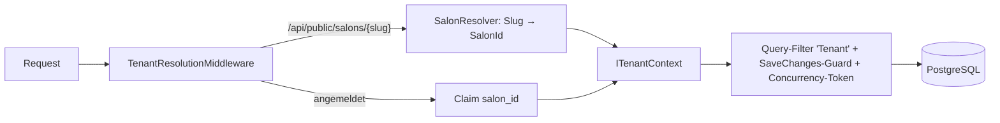

# Architektur (Gerüst)

Wird mit jedem Schritt erweitert; die verbindlichen Regeln stehen in [CLAUDE.md](../CLAUDE.md).

## Überblick

Angular (Frontend) → ASP.NET Core 10 Web API → PostgreSQL. Auslieferung und HTTPS über Caddy.

## Aufrufkette

Browser: Komponente → Feature-Service → ApiClient → Caddy (`/api`) → Server: Controller → Service (hinter Interface) → EF Core (`IAppDbContext`) → PostgreSQL.

## Schichten (Backend)

- `Kalora.Api` – Controller, Middleware, `Program.cs`
- `Kalora.Application` – Service-Interfaces und Implementierungen, DTOs, Validatoren, `IAppDbContext`
- `Kalora.Domain` – Entitäten, reine Regeln (Verfügbarkeit, Statusautomat), keine Abhängigkeiten
- `Kalora.Infrastructure` – EF Core, Migrationen, Mail, Kalender, `TimeProvider`

## Mandantenfähigkeit

Alle Salons teilen sich eine Datenbank; jede salonbezogene Tabelle trägt `SalonId`. Begründung und verworfene Alternativen: [ADR 0001](adr/0001-multi-tenancy.md).

- **Lesen:** globaler Query-Filter auf `Salon` und allen `ISalonOwned`-Entitäten; ohne Mandant keine Daten.
- **Schreiben:** `TenantSaveGuard` setzt/prüft `SalonId`, `SalonId` ist zusätzlich Concurrency-Token (gefälschte Entitäten treffen keine Zeile).
- **Umgehung:** nur `AllSalons()` / `AllTenants<T>()`, per Architekturtest auf eine feste Dateiliste beschränkt.

## Anmeldung und Rollen

Begründung: [ADR 0002](adr/0002-authentication.md). Cookie-Sitzung (ASP.NET Core Identity), ein Nutzer gehört zu genau einem Salon; Salon und Rolle stehen als Claims im Cookie.

| Endpunkt | Zugriff | Zweck |
|----------|---------|-------|
| `GET /api/antiforgery` | offen | setzt das `XSRF-TOKEN`-Cookie; schreibende Anfragen senden es als `X-XSRF-TOKEN` |
| `POST /api/auth/register` | offen | Inhaber:in + Salon (30 Tage Test) anlegen, anmelden |
| `POST /api/auth/login`, `/logout` | offen | Sitzung starten/beenden; mit aktiver 2FA zusätzlich `twoFactorCode` oder `recoveryCode` |
| `POST /api/auth/confirm-email`, `/forgot-password`, `/reset-password` | offen | E-Mail bestätigen, Passwort zurücksetzen |
| `GET /api/me` | angemeldet | Profil, Salon, Rolle, 2FA-Status |
| `POST /api/auth/two-factor/setup`, `/enable`, `/disable`, `/recovery-codes` | angemeldet | TOTP einrichten und verwalten |
| `POST /api/invitations` | Owner, Manager | Mitarbeitende einladen (Manager nur als Staff) |
| `GET /api/public/invitations/{token}`, `POST …/accept` | Token | Einladung ansehen und annehmen |

Policies: `SalonMember` (Owner, Manager, Staff), `SalonManager` (Owner, Manager), `SalonOwner`, `PlatformAdmin`. Fehlercodes u. a.: `auth.invalid_credentials`, `auth.locked_out`, `auth.two_factor_required`, `auth.email_taken`, `auth.invalid_token`, `invitation.invalid`, `invitation.expired`, `security.antiforgery_failed`.

## Frontend-Gerüst

Angular 22 (Standalone, zoneless, Signals, OnPush) mit Angular Material 3. Quelltext in `frontend/src/app`:

- `core/http` – `ApiClient` (einziger Nutzer von `HttpClient`, präfixt `/api`), `ApiError` (ProblemDetails → typisierter Fehler mit Code), Interceptoren in dieser Reihenfolge: Credentials → Fehler (Snackbar, außer 401 und `silent`) → Antiforgery-Wiederholung. Schreibende Anfragen tragen den Header `X-XSRF-TOKEN` (Angulars XSRF-Unterstützung); lehnt der Server wegen eines fehlenden oder veralteten Tokens ab (`security.antiforgery_failed`), holt `AntiforgeryService` ein neues und wiederholt die Anfrage einmal.
- `core/i18n` – Transloco (de, en, tr). Startsprache: gespeicherte Wahl → Profil → Browser → de. Texte unter `public/i18n/<sprache>.json` (gemeinsam) und `public/i18n/<feature>/<sprache>.json` (je Feature, per `provideTranslocoScope` mit dem Feature geladen). `LocaleFormatService` und die Pipes `localDate` / `money` formatieren Datum, Zeit (in der Zeitzone des Salons) und Geld nach Sprache.
- `core/layout` – `Shell` für den Salon-Bereich (Seitenleiste ab 900 px, sonst untere Navigation) und `PublicLayout` für Kundenseiten; Seitentitel folgen der Sprache.
- `core/theme` – hell, dunkel oder wie das Gerät (CSS `color-scheme`).
- `shared/` – wiederverwendbare Bausteine (Sprach- und Theme-Umschalter, Pipes). `features/<name>/` – Seite, Service und Modelle eines Bereichs, jeweils lazy geladen.

Routen: `/app/{dashboard,calendar,requests,services,team,settings}` (Salon-Bereich), `/:slug` (öffentliche Buchungsseite), sonst 404. Reservierte Slugs (`app`, `admin`, `auth`, `api`, `m`, …) verhindert das Backend (`SlugGenerator`).

Schrift (Inter) und Icons (Material Icons Outlined) liegen lokal im Build, es gibt keine Anfragen an externe Hosts. `npm run i18n:check` meldet Schlüssel, die in einer Sprache fehlen.

## Backend-Gerüst

- **Projektreferenzen:** `Api → Application → Domain`; `Infrastructure → Application`; `Api` referenziert `Infrastructure` nur, um es per `AddInfrastructure` zu registrieren (Composition Root).
- **DI:** pro Schicht eine Extension-Methode (`AddApplication`, `AddInfrastructure`); `Program.cs` bleibt kurz. Service-Implementierungen sind `internal`.
- **Fehlerbehandlung:** Services liefern `Result<T>` / `Result` mit `Error(Type, Code, Parameter)`. `ProblemDetailsMapper` (Api) übersetzt `ErrorType` in 400, 401, 403, 404, 409, 422 und setzt `code` (und optional `parameter`) als Extension. Unerwartete Exceptions fängt `GlobalExceptionHandler` ab (500, `server.unexpected`, ohne Details).
- **Dumme Controller:** Beispiel `PingController` → `IPingService`; Ableitung von `ApiControllerBase` übersetzt das `Result`.
- **Konfiguration:** `appsettings.json` + Umgebungsvariablen (`App__PublicBaseUrl`). Options-Klassen werden beim Start validiert (`ValidateOnStart`); ungültige Konfiguration stoppt den Host.
- **Logging/Betrieb:** Serilog (Konsole, aus Konfiguration), Request-Logging nur mit Pfad, Health-Check `/health`. OpenAPI (`/openapi/v1.json`) und Scalar (`/scalar/v1`) nur in Development.
- **Zeit:** `TimeProvider` wird über DI geliefert (`TimeProvider.System`, in Tests `FakeTimeProvider`).

## Datenbank

PostgreSQL 18, EF Core Code-First, Migrationen in `Kalora.Infrastructure/Persistence/Migrations`. Tabellen und Spalten in snake_case (`EFCore.NamingConventions`), Enums als Text, Geld als Cent, Zeitpunkte als `timestamptz` (UTC), Öffnungs-/Arbeitszeiten als `time` + Wochentag (`smallint`, 0 = Sonntag).

| Tabelle | Zweck |
|---------|-------|
| `salons` | Mandant; `id` ist die SalonId aller anderen Tabellen |
| `salon_opening_hours`, `salon_closures` | Öffnungszeiten (mehrere Blöcke pro Tag), Schließtage |
| `salon_members` | Nutzer ↔ Salon mit Rolle (Owner, Manager, Staff); FK auf `AppUser` folgt mit Identity |
| `staff_members`, `staff_working_hours`, `staff_absences` | Mitarbeitende, Dienstplan mit Gültigkeit, Abwesenheiten |
| `service_categories`, `services`, `staff_services` | Leistungskatalog, Fähigkeiten (optional mit eigener Dauer) |
| `customers` | Kunden, pro Salon getrennt; E-Mail eindeutig je Salon |
| `appointments`, `time_blocks` | Termine (mit Snapshot von Name/Preis/Dauer), Blocker |
| `email_outbox`, `audit_logs` | Mail-Warteschlange, Nachvollziehbarkeit |

- **Basisklasse `Entity`:** `Id` als GUID v7, `CreatedAtUtc`, `UpdatedAtUtc`. `ISalonOwned` markiert Entitäten mit `SalonId`.
- **Zeitstempel:** `AuditTimestampInterceptor` setzt sie bei jedem Speichern über `TimeProvider`.
- **Löschverhalten:** Kindtabellen eines Mitarbeitenden bzw. einer Leistung (Dienstplan, Abwesenheiten, Fähigkeiten, Blocker) werden mitgelöscht; alles andere ist `Restrict`. Mitarbeitende und Leistungen werden deaktiviert statt gelöscht, sobald Termine existieren.
- **Doppelbuchungsschutz:** `appointments.blocked_range` ist eine aus `blocked_start_utc`/`blocked_end_utc` (Termin plus Puffer) erzeugte `tstzrange`-Spalte (`[)`, Back-to-back erlaubt). Der Exclusion-Constraint `ex_appointments_no_overlap` (`btree_gist`) verbietet pro `staff_id` überlappende Termine mit Status `Requested` oder `Confirmed`. Bei Verletzung meldet PostgreSQL SQLSTATE `23P01`; der Buchungsservice übersetzt das später in `booking.slot_unavailable`.
- **Migrationen:** In Development beim Start automatisch (`MigrateDatabaseAsync`), in Produktion als eigener Schritt (Migrationsbundle, Prompt 25). `btree_gist` ist eine „trusted extension“, der Datenbankbesitzer darf sie anlegen.

## Offene Abschnitte

Statusautomat, Verfügbarkeitsberechnung, Hintergrunddienste.
